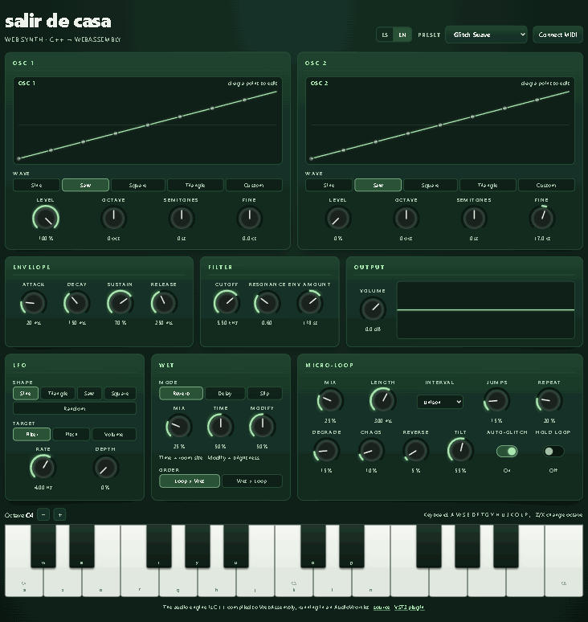
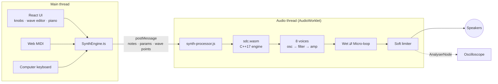

<div align="center">

# Salir de Casa Online

**A glitch synthesizer that runs in your browser.**
A C++ DSP engine compiled to WebAssembly, running in real time inside an AudioWorklet, with a React + TypeScript interface.

[Español](README.md) · **English**

[](https://pedrofelipe14.github.io/salir-de-casa-web-synth/)

[](https://github.com/pedrofelipe14/salir-de-casa-web-synth/actions/workflows/ci.yml)


<a href="https://pedrofelipe14.github.io/salir-de-casa-web-synth/"></a>

</div>

It's the browser version of my [Salir de Casa VST3 plugin](https://github.com/pedrofelipe14/GlitchSynth), the instrument I use to make music. Same sound engine, same parameters, same factory presets, rebuilt without JUCE so it can run anywhere.

## What this project shows

| | |
|---|---|
| **Real-time audio programming** | The full chain (8 voices, 2 oscillators, reverb and granular glitch) uses **about 2 % of the real-time budget**. There are no allocations and no locks on the audio thread. |
| **Systems C++** | A header-only C++17 engine with no dependencies. The same code is compiled natively for the tests and to WebAssembly for the browser. |
| **Web platform depth** | AudioWorklet, WebAssembly loaded **with no Emscripten JS glue**, Web MIDI, pointer events, and an accessible UI (ARIA sliders and keyboard control on every knob). |
| **Porting and parity** | The plugin's granular micro-looper and wet effects are ported line by line, and Freeverb is implemented by hand to match JUCE's reverb. |
| **Engineering practice** | **58 tests** in two languages, including a contract test that fails if the C++ and TypeScript parameter tables drift apart. CI runs every check, then deploys to GitHub Pages. |
| **Product sense** | It opens on a preset that sounds good, plays from the computer keyboard, a MIDI controller or a touchscreen, and the interface is available in **English and Spanish**. |

## Try it in 30 seconds

1. Open the **[live demo](https://pedrofelipe14.github.io/salir-de-casa-web-synth/)** and press **▶ Turn on the sound**.
2. Play with the keyboard: **A S D F G H J** are the white keys and **W E T Y U** the black ones. **Z / X** change octave.
3. Pick the **Caos Total** or **Loop Congelado** preset: the micro-loop starts freezing and bit-crushing what you play.
4. **Drag a point** on the OSC 1 graph while you hold a note, and hear the waveform change.
5. Plug in a MIDI keyboard and press **Connect MIDI**.

## Performance

Measured with `npm run bench` (Node 24, AMD Ryzen 5 5500). The chain renders at 48 kHz in 128-frame blocks, which gives the engine a **2,667 µs** budget per block.

| Load | Time per block | Real-time budget used |
|---|---:|---:|
| 8 voices, 1 oscillator | 39 µs | 1.5 % |
| 8 voices, 2 oscillators + reverb | 44 µs | 1.6 % |
| 8 voices, 2 oscillators + reverb + micro-loop | 50 µs | 1.9 % |
| 8 voices, custom wave + slip + micro-loop | 52 µs | 1.9 % |

## Architecture



**Inside the engine (`dsp/include/sdc/`)**

- `oscillator.h`: PolyBLEP anti-aliased saw and square waves, plus a custom wave read from a table.
- `custom_wave.h`: 8 draggable points joined by a periodic Catmull-Rom curve and rendered into a 256-sample table.
- `filter.h`: a TPT state-variable low-pass (Zavalishin / Simper), stable under audio-rate cutoff modulation.
- `voice.h`: two oscillators, ADSR, a per-voice LFO, DC blocking, and de-clicking when a voice is stolen.
- `wet.h`, `reverb.h`: reverb (Freeverb), tape delay with darkening repeats, and slip (reverse or octave-shifted repeats).
- `glitch.h`: a granular micro-looper that records live input and freezes and crossfades grains. It transposes them by musical intervals, flips them backwards and bit-crushes them as they repeat. "Chaos" adds tape wow.
- `synth.h`: voice allocation, stealing released voices first and then the oldest, plus routing that matches the plugin's `processBlock`.

## Engineering decisions

- **No JUCE in the engine.** JUCE doesn't target the browser. Writing the DSP as dependency-free headers lets one codebase build for native tests and for WebAssembly.
- **A standalone `.wasm` with no JS glue.** AudioWorklets can't fetch or import scripts on their own. The main thread fetches the bytes once and passes them in, and the worklet instantiates the module itself. That keeps it to 56 KB and avoids a loader.
- **Nothing allocates on the audio thread.** Every buffer is allocated in `prepare()`, and WebAssembly memory growth is turned off. That makes the `Float32Array` views over the output buffers permanently valid.
- **Messages instead of SharedArrayBuffer.** SharedArrayBuffer needs COOP/COEP headers that GitHub Pages can't send. Parameter changes are rare compared with 375 audio blocks a second, so messages are enough.
- **Two parameter tables, one contract.** The UI needs labels, units and knob curves, while the engine needs ranges. A test parses the C++ header and compares the two tables, so they can't silently disagree.
- **Clicks are bugs.** Grain boundaries are crossfaded, stolen voices fade out, parameters are smoothed, and square or random LFO steps are slightly rounded.

## Tests

- **24 native C++ tests** (`dsp/tests`), built with `/W4` and `-Wall -Wextra -Wpedantic` and no warnings. They check that:
  - oscillators stay bounded, have no DC offset and the custom waveform follows its points;
  - envelope timing is right;
  - the filter passes low frequencies and cuts high ones, and stays stable at extreme settings;
  - voice stealing works and the output never exceeds full scale;
  - reverb and delay leave tails, and slip mode stays stable at every speed;
  - the micro-loop runs only with Auto-Glitch on, keeps looping when held, and otherwise fades out with the input.
- **34 web tests** (Vitest) cover:
  - knob curves and value formatting;
  - the computer-keyboard layout;
  - translations: nothing exists in only one language;
  - the C++ ↔ TypeScript parameter contract;
  - the **real compiled `sdc.wasm`**: it plays notes, runs the micro-loop and goes silent when notes are released.
- **CI** (GitHub Actions) runs the native tests, builds the engine with Emscripten, runs the typecheck, tests and build, and then deploys to GitHub Pages.

## Running locally

Requirements: [Emscripten](https://emscripten.org/docs/getting_started/downloads.html), Node 20+ and CMake.

```sh
./scripts/build-wasm.sh              # C++ → web/public/sdc.wasm

cd web
npm install
npm run dev                          # http://localhost:5173
npm test                             # web tests (needs the .wasm)
npm run bench                        # real-time budget benchmark

# native DSP tests
cmake -S dsp -B dsp/build && cmake --build dsp/build && ctest --test-dir dsp/build
```

## Project layout

```
dsp/
  include/sdc/   the engine (header-only C++17)
  src/           wasm_api.cpp: the C API exported to WebAssembly
  tests/         native tests
web/
  public/        synth-processor.js (AudioWorklet) and the built sdc.wasm
  src/engine/    engine bridge, parameter table, presets, waveform math, keyboard
  src/components/ Knob, WaveEditor, Piano, Scope, Choice, Toggle, Dropdown
scripts/         build-wasm.sh
```

## Stack

C++17 · WebAssembly (Emscripten) · Web Audio API (AudioWorklet) · Web MIDI · React 19 · TypeScript · Vite · Vitest · CMake · GitHub Actions · GitHub Pages
