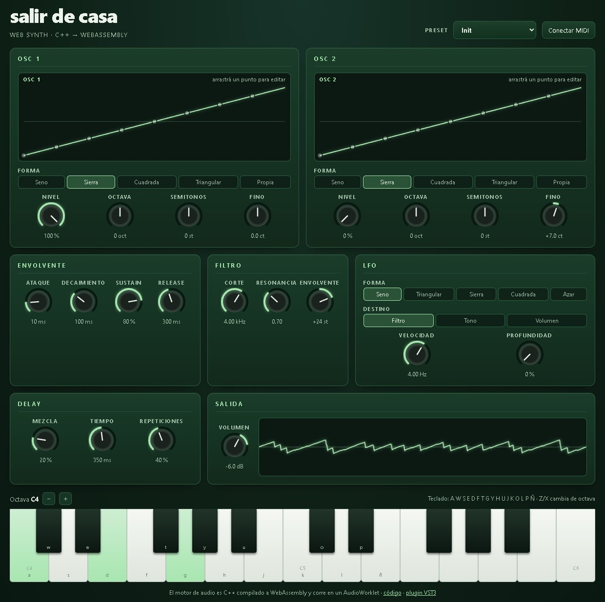

# Salir de Casa — sintetizador web

[English](README.md) · **Español**

[](https://github.com/pedrofelipe14/salir-de-casa-web-synth/actions/workflows/ci.yml)

Un sintetizador polifónico que corre en el navegador. Su motor de audio es **C++ compilado a WebAssembly** y funciona en tiempo real dentro de un **AudioWorklet**. La interfaz está hecha con **React + TypeScript**.
Es la versión web del [plugin VST3 Salir de Casa](https://github.com/pedrofelipe14/GlitchSynth).

**▶ Tocalo:** https://pedrofelipe14.github.io/salir-de-casa-web-synth/



## Qué tiene

- **Polifonía de 8 voces**. Cuando están todas ocupadas reutiliza una: primero las que se están apagando, después la más vieja.
- **Dos osciladores** por voz: seno, sierra, cuadrada, triangular o una **onda propia que se dibuja arrastrando puntos**.
- **Filtro pasa-bajos resonante** con envolvente y **ADSR** de amplitud.
- **LFO** hacia filtro, tono o volumen (seno, triangular, sierra, cuadrada o aleatorio).
- **Delay estéreo ping-pong** con repeticiones amortiguadas, y limitador suave de salida.
- Se toca con el **mouse o el dedo** (arrastrando hacés glissando), con el **teclado de la computadora** o con un **controlador MIDI** (Web MIDI).
- **Presets** y **osciloscopio** en vivo.

## Cómo funciona

```
Interfaz React (hilo principal)               AudioWorklet (hilo de audio)
  perillas · editor de onda · teclado · MIDI ──►  synth-processor.js
           postMessage(nota / parámetro)            └─ sdc.wasm  (motor C++, 39 KB)
                                                       8 voces → delay → limitador → parlantes
```

- **`dsp/`**: el motor, en C++17 portable, solo en headers y sin dependencias.
  - Osciladores con anti-aliasing PolyBLEP.
  - Una curva Catmull-Rom para la onda propia.
  - Un filtro *state-variable* TPT, estable con modulación rápida.
  - ADSR lineal, LFO por voz, bloqueo de DC y *de-click* al reutilizar voces.
- **`dsp/src/wasm_api.cpp`**: una API en C chiquita que Emscripten compila a un **`.wasm` independiente, sin código JavaScript intermedio**. El worklet lo carga directamente y lee el audio de la memoria del módulo, sin pedir memoria nueva en el hilo de audio.
- **`web/`**: la app de React. Las notas y los cambios de parámetros viajan al worklet como mensajes. La interfaz tiene una copia en TypeScript de la tabla de parámetros del motor, y un test falla si alguna vez dejan de coincidir.

## Tests

- **17 tests nativos en C++** sobre el DSP:
  - los osciladores no se pasan de rango y no tienen offset de DC;
  - la onda propia sigue sus puntos;
  - la envolvente respeta sus tiempos;
  - el filtro deja pasar los graves, corta los agudos y es estable en valores extremos;
  - la reutilización de voces funciona y la salida nunca supera el máximo.
- **26 tests web con Vitest**:
  - mapeo de las perillas, formato de los valores y teclado de la computadora;
  - que la tabla de parámetros coincida con el header de C++;
  - cargan el **`sdc.wasm` compilado real** y verifican que toque notas y que haga silencio al soltarlas.
- **GitHub Actions** corre todo en cada push y después publica el sitio en GitHub Pages.

## Correrlo localmente

Requisitos: [Emscripten](https://emscripten.org/docs/getting_started/downloads.html), Node 20 o más nuevo y CMake (para los tests nativos).

```sh
./scripts/build-wasm.sh          # C++ → web/public/sdc.wasm

cd web
npm install
npm run dev                      # http://localhost:5173
npm test

# tests nativos del DSP
cmake -S dsp -B dsp/build && cmake --build dsp/build && ctest --test-dir dsp/build
```

## Stack

C++17 · WebAssembly (Emscripten) · Web Audio API (AudioWorklet) · Web MIDI · React · TypeScript · Vite · Vitest · CMake · GitHub Actions · GitHub Pages
