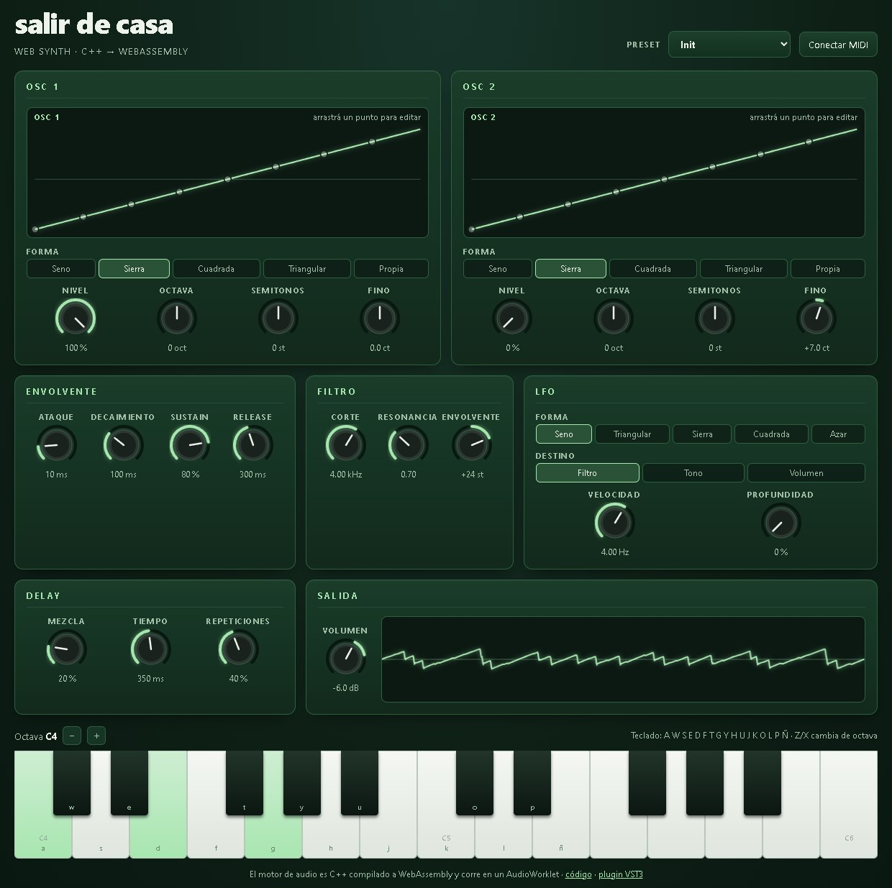

# Salir de Casa — web synth

**English** · [Español](README.es.md)

[](https://github.com/pedrofelipe14/salir-de-casa-web-synth/actions/workflows/ci.yml)

A polyphonic synthesizer that runs in the browser. Its audio engine is **C++ compiled to WebAssembly** and runs in real time inside an **AudioWorklet**; the interface is **React + TypeScript**.
It's the web version of the [Salir de Casa VST3 plugin](https://github.com/pedrofelipe14/GlitchSynth).

**▶ Play it:** https://pedrofelipe14.github.io/salir-de-casa-web-synth/



## Features

- **8-voice polyphony** with voice stealing: releasing voices first, then the oldest.
- **Two oscillators** per voice: sine, saw, square, triangle, or a **custom waveform you shape by dragging points**.
- **Resonant low-pass filter** with envelope modulation, plus an amplitude **ADSR**.
- **LFO** routed to filter, pitch or volume (sine, triangle, saw, square or sample & hold).
- **Stereo ping-pong delay** with damped repeats, and a soft output limiter.
- Play it with the **mouse or touch** (slide for glissando), the **computer keyboard** or a **MIDI controller** (Web MIDI).
- **Presets** and a live **oscilloscope**.

## How it works

```
React UI (main thread)                      AudioWorklet (audio thread)
  knobs · wave editor · keyboard · MIDI ──►   synth-processor.js
           postMessage(note / param)           └─ sdc.wasm  (C++ engine, 39 KB)
                                                   8 voices → delay → limiter → speakers
```

- **`dsp/`**: the engine in portable, header-only C++17 with no dependencies.
  - PolyBLEP anti-aliased oscillators.
  - A Catmull-Rom curve for the custom waveform.
  - A TPT state-variable filter (stable under fast modulation).
  - Linear ADSR, per-voice LFO, DC blocking and de-clicking on voice steals.
- **`dsp/src/wasm_api.cpp`**: a small C API compiled with Emscripten to a **standalone `.wasm` with no JS glue**. The worklet instantiates it directly and reads audio straight from the module's memory, with no allocations on the audio thread.
- **`web/`**: the React app. Parameter changes and notes travel to the worklet as messages. The UI keeps a TypeScript mirror of the engine's parameter table, and a test fails if the two ever drift apart.

## Tests

- **17 native C++ tests** cover the DSP: oscillators stay bounded with no DC offset, the custom waveform follows its points, envelope timing is right, the filter passes lows and cuts highs, it stays stable at extreme settings, voice stealing works, and the output never exceeds full scale.
- **26 web tests (Vitest)** cover knob mapping, value formatting and the computer-keyboard layout. They also check that the parameter table matches the C++ header, and they **load the real compiled `sdc.wasm`** to check it plays notes and goes quiet when they're released.
- **GitHub Actions** runs all of it on every push, then deploys the site to GitHub Pages.

## Running locally

Requirements: [Emscripten](https://emscripten.org/docs/getting_started/downloads.html), Node 20+ and CMake (for the native tests).

```sh
./scripts/build-wasm.sh          # C++ → web/public/sdc.wasm

cd web
npm install
npm run dev                      # http://localhost:5173
npm test

# native DSP tests
cmake -S dsp -B dsp/build && cmake --build dsp/build && ctest --test-dir dsp/build
```

## Stack

C++17 · WebAssembly (Emscripten) · Web Audio API (AudioWorklet) · Web MIDI · React · TypeScript · Vite · Vitest · CMake · GitHub Actions · GitHub Pages
