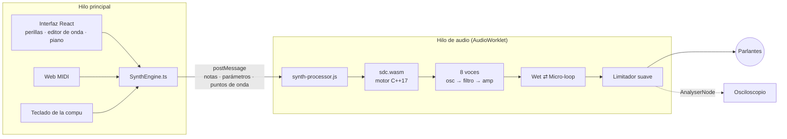

<div align="center">

# Salir de Casa — Sintetizador web

**Un sintetizador glitch que corre en el navegador.**
Un motor DSP en C++ compilado a WebAssembly, que funciona en tiempo real dentro de un AudioWorklet, con interfaz en React + TypeScript.

**Español** · [English](README.en.md)

[](https://pedrofelipe14.github.io/salir-de-casa-web-synth/)

[](https://github.com/pedrofelipe14/salir-de-casa-web-synth/actions/workflows/ci.yml)


<a href="https://pedrofelipe14.github.io/salir-de-casa-web-synth/"></a>

</div>

Es la versión para navegador de mi [plugin VST3 Salir de Casa](https://github.com/pedrofelipe14/GlitchSynth), el instrumento que uso para hacer música. Mismo motor de sonido, mismos parámetros y mismos presets de fábrica, reescrito sin JUCE para que corra en cualquier lado.

## Qué demuestra este proyecto

| | |
|---|---|
| **Programación de audio en tiempo real** | La cadena completa (8 voces, 2 osciladores, reverb y glitch granular) usa **alrededor del 2 % del tiempo disponible**. No pide memoria ni usa locks en el hilo de audio. |
| **C++ de sistemas** | Un motor en C++17, solo en headers y sin dependencias. El mismo código compila nativo para los tests y a WebAssembly para el navegador. |
| **Plataforma web a fondo** | AudioWorklet, WebAssembly cargado **sin el código JavaScript intermedio de Emscripten**, Web MIDI, pointer events e interfaz accesible (sliders ARIA y control por teclado en todas las perillas). |
| **Port y paridad** | El micro-looper granular y los efectos WET del plugin están portados línea por línea, y Freeverb está implementado a mano para igualar la reverb de JUCE. |
| **Prácticas de ingeniería** | **58 tests** en dos lenguajes, incluido un test de contrato que falla si las tablas de parámetros de C++ y TypeScript dejan de coincidir. El CI corre todo y después publica en GitHub Pages. |
| **Criterio de producto** | Arranca con un preset que ya suena bien, se toca con el teclado de la compu, un controlador MIDI o una pantalla táctil, y la interfaz está en **español e inglés**. |

## Probalo en 30 segundos

1. Abrí la **[demo en vivo](https://pedrofelipe14.github.io/salir-de-casa-web-synth/)** y tocá **▶ Encender el sonido**.
2. Tocá con el teclado: **A S D F G H J** son las teclas blancas y **W E T Y U** las negras. **Z / X** cambian de octava.
3. Elegí el preset **Caos Total** o **Loop Congelado**: el micro-loop empieza a congelar y degradar lo que tocás.
4. **Arrastrá un punto** del gráfico de OSC 1 mientras mantenés una nota, y escuchá cómo cambia la onda.
5. Si tenés un teclado MIDI, conectalo con **Conectar MIDI**.

## Rendimiento

Medido con `npm run bench` (Node 24, AMD Ryzen 5 5500). La cadena se procesa a 48 kHz en bloques de 128 muestras, así que el motor tiene **2.667 µs** disponibles por bloque.

| Carga | Tiempo por bloque | Tiempo disponible usado |
|---|---:|---:|
| 8 voces, 1 oscilador | 39 µs | 1,5 % |
| 8 voces, 2 osciladores + reverb | 44 µs | 1,6 % |
| 8 voces, 2 osciladores + reverb + micro-loop | 50 µs | 1,9 % |
| 8 voces, onda propia + slip + micro-loop | 52 µs | 1,9 % |

## Arquitectura



**Dentro del motor (`dsp/include/sdc/`)**

- `oscillator.h`: sierra y cuadrada con anti-aliasing PolyBLEP, más una onda propia que se lee de una tabla.
- `custom_wave.h`: 8 puntos arrastrables unidos por una curva Catmull-Rom periódica, que se guarda en una tabla de 256 muestras.
- `filter.h`: un pasa-bajos *state-variable* TPT (Zavalishin / Simper), estable aunque el corte se module muy rápido.
- `voice.h`: dos osciladores, ADSR, un LFO por voz, bloqueo de DC y *de-click* cuando se reutiliza una voz.
- `wet.h`, `reverb.h`: reverb (Freeverb), delay de cinta con repeticiones que se oscurecen, y slip (repeticiones al revés o a otra octava).
- `glitch.h`: un micro-looper granular que graba la entrada en vivo y congela granos, con fundidos entre uno y otro. Los transpone a intervalos musicales, los da vuelta y los degrada a medida que se repiten. "Caos" le suma vibrato de cinta.
- `synth.h`: reparte las notas entre las voces, reutiliza primero las que se están apagando y después la más vieja, y rutea igual que el `processBlock` del plugin.

## Decisiones técnicas

- **Sin JUCE en el motor.** JUCE no compila para el navegador. Escribir el DSP como headers sin dependencias permite usar el mismo código para los tests nativos y para WebAssembly.
- **Un `.wasm` independiente, sin código JavaScript intermedio.** Un AudioWorklet no puede descargar ni importar scripts por su cuenta. El hilo principal baja los bytes una vez y se los pasa, y el worklet carga el módulo directamente. Así pesa 56 KB y no hace falta un cargador.
- **Nada pide memoria en el hilo de audio.** Todos los buffers se crean en `prepare()` y el crecimiento de memoria de WebAssembly está desactivado. Por eso las vistas `Float32Array` sobre los buffers de salida nunca dejan de ser válidas.
- **Mensajes en lugar de SharedArrayBuffer.** SharedArrayBuffer necesita headers COOP/COEP que GitHub Pages no manda. Los cambios de parámetros son pocos comparados con los 375 bloques de audio por segundo, así que los mensajes alcanzan.
- **Dos tablas de parámetros, un contrato.** La interfaz necesita nombres, unidades y curvas de perilla, y el motor necesita rangos. Un test lee el header de C++ y compara las dos tablas, así nunca pueden quedar distintas sin que se note.
- **Un click es un bug.** Los granos tienen fundidos entre sí, las voces reutilizadas se apagan suave, los parámetros cambian de forma gradual y los saltos del LFO cuadrado o aleatorio se redondean un poco.

## Tests

- **24 tests nativos en C++** (`dsp/tests`), compilados con `/W4` y `-Wall -Wextra -Wpedantic` sin un solo warning. Verifican que:
  - los osciladores no se pasan de rango, no tienen DC y la onda propia sigue sus puntos;
  - la envolvente respeta sus tiempos;
  - el filtro deja pasar los graves, corta los agudos y es estable en valores extremos;
  - la reutilización de voces funciona y la salida nunca supera el máximo;
  - la reverb y el delay dejan cola, y el slip es estable en todas sus velocidades;
  - el micro-loop solo corre con Auto-Glitch, sigue con "Mantener" y, si no, se apaga con la entrada.
- **34 tests web** (Vitest) cubren:
  - curvas de las perillas y formato de los valores;
  - el teclado de la compu;
  - traducciones: no queda nada en un solo idioma;
  - el contrato de parámetros entre C++ y TypeScript;
  - el **`sdc.wasm` compilado real**: toca notas, corre el micro-loop y hace silencio al soltarlas.
- **CI** (GitHub Actions): corre los tests nativos, compila el motor con Emscripten, hace el chequeo de tipos, los tests y el build, y publica en GitHub Pages.

## Correrlo localmente

Requisitos: [Emscripten](https://emscripten.org/docs/getting_started/downloads.html), Node 20 o más nuevo y CMake.

```sh
./scripts/build-wasm.sh              # C++ → web/public/sdc.wasm

cd web
npm install
npm run dev                          # http://localhost:5173
npm test                             # tests web (necesitan el .wasm)
npm run bench                        # benchmark de tiempo real

# tests nativos del DSP
cmake -S dsp -B dsp/build && cmake --build dsp/build && ctest --test-dir dsp/build
```

## Estructura

```
dsp/
  include/sdc/   el motor (C++17, solo headers)
  src/           wasm_api.cpp: la API en C que se exporta a WebAssembly
  tests/         tests nativos
web/
  public/        synth-processor.js (AudioWorklet) y el sdc.wasm compilado
  src/engine/    puente al motor, tabla de parámetros, presets, matemática de la onda, teclado
  src/components/ Knob, WaveEditor, Piano, Scope, Choice, Toggle, Dropdown
scripts/         build-wasm.sh
```

## Stack

C++17 · WebAssembly (Emscripten) · Web Audio API (AudioWorklet) · Web MIDI · React 19 · TypeScript · Vite · Vitest · CMake · GitHub Actions · GitHub Pages
